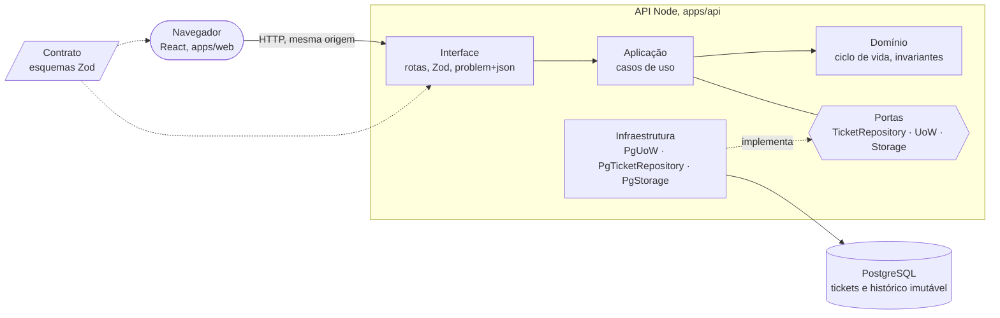

# ticketdesk

[](https://github.com/geldois/ticketdesk/actions/workflows/check.yml)
[](https://github.com/geldois/ticketdesk/actions/workflows/test.yml)
[](https://github.com/geldois/ticketdesk/actions/workflows/audit.yml)
[](.node-version)
[](package.json)
[](LICENSE)

Sistema de tickets de atendimento full-stack em TypeScript, Node e PostgreSQL: uma operadora registra tickets de
clientes, acompanha o andamento até a resolução, consulta o histórico de cada mudança e nunca sobrescreve, sem aviso, a
alteração de outra operadora.

O foco foi o rigor onde uma falha custa dado: a concorrência, o histórico e o erro consistente, cada um provado por
teste contra um PostgreSQL real. A [filosofia](#filosofia-de-engenharia) explica por que isso veio antes dos opcionais.

## Visão geral da arquitetura

A API é hexagonal: o domínio não importa nada de fora, os casos de uso falam com o banco por uma porta, e só a
infraestrutura conhece o PostgreSQL. As quatro camadas moram em `apps/api/src/`, e o ESLint reprova um import do domínio
para fora dele. O front é um pacote à parte, `apps/web`, e os dois lados leem o mesmo contrato, em `packages/contract`.



A requisição entra pela interface, que só valida a forma, e desce pela aplicação até o domínio, onde moram as regras. A
aplicação define as portas, e a infraestrutura as implementa sobre o PostgreSQL, então nada acima dela sabe que o banco
existe. O `main.ts` é a única peça que liga as duas pontas: cria o `PgStorage` e chama o `buildContainer`, que monta os
casos de uso à mão, sem framework de injeção. O pacote de contrato é lido pelos dois lados, o front e a API.

| Camada | O que decide | Onde |
| --- | --- | --- |
| Domínio | As transições permitidas, a nota e o motivo que cada destino exige, a normalização e os limites do texto | `domain/` |
| Aplicação | Orquestra uma operação, abre e confirma a transação pela unidade de trabalho e decide o 404 e o conflito; define as portas do repositório e da unidade de trabalho | `application/` |
| Infraestrutura | A unidade de trabalho sobre o PostgreSQL, o `UPDATE` condicional à `version` e as migrations | `infrastructure/` |
| Interface | Rotas, validação da forma, `If-Match`/`ETag`, `Link` da paginação e o erro em `application/problem+json` | `interface/` |

Três propriedades seguram o sistema, e o [Registro de decisões](#registro-de-decisões) traz o porquê de cada uma:

- **Uma corrida tem um só vencedor.** A transição é um `UPDATE` condicional à `version` que a operadora leu. Quem perde
  recebe `409 version_conflict` com o ticket atual, e a tela avisa e mostra o estado novo.
- **A regra mora num lugar só.** A tela não guarda máquina de estados: cada ticket diz para onde pode ir e que texto a
  transição exige (`nextTransitions`), lido das mesmas tabelas do domínio que validam a escrita.
- **O histórico não se altera.** Gatilhos do banco recusam `UPDATE`, `DELETE` e `TRUNCATE` em `ticket_history_entry`.

| Rota | O que faz |
| --- | --- |
| `POST /tickets` | Cria o ticket, sempre `open`, e devolve `201` |
| `GET /tickets` | Lista com filtro por `status` e `channel`, paginada por cursor: a próxima página vem no `Link` |
| `GET /tickets/:id` | Devolve o ticket e o `ETag` com a `version` |
| `POST /tickets/:id/transitions` | Transita, com `If-Match`; `resolved` exige `note` e a reabertura exige `reason` |
| `GET /tickets/:id/history` | Devolve as mudanças de status, na ordem em que foram gravadas |
| `GET /health` e `GET /health/ready` | Vida do processo, sem tocar o banco, e prontidão, com uma consulta constante ao banco; sem resposta no prazo, a prontidão devolve `503` |

Toda falha sai como `application/problem+json` com um `code` estável (`invalid_transition`, `missing_resolution_note`,
`version_conflict`, `invalid_cursor` e os demais): `400` para a requisição malformada, `404`, `409` para o conflito,
`413` para o corpo grande demais, `422` para a regra de negócio que o domínio recusa, `428` para a transição sem
`If-Match` e `503` para a prontidão sem banco.

## Como rodar

Há três caminhos, todos na raiz do repositório, e `docker compose` é o comando de compose do seu container runtime.

| Quero | Preciso de | Vá para |
| --- | --- | --- |
| Rodar o sistema e ver a API responder | Só um container runtime, sem Node e sem `npm ci` | "Só rodar" |
| Mexer no código, conferir lint e tipos e rodar a API no host | O Node do `.node-version` e, para o banco da API do host, um container runtime | "Para quem desenvolve" |
| Rodar os testes | O Node do `.node-version` e um container runtime | "Para quem desenvolve" |

### Só rodar

Dois comandos, um por vez:

```sh
cp .env.example .env
docker compose up -d
```

O `docker compose up -d` constrói as imagens, sobe o `db`, aplica as migrations e sobe a API, que serve também a página
do front. Nenhuma dependência é instalada no seu host.

Com o `.env.example` sem alterar, a API responde em `http://127.0.0.1:3001` (`API_PUBLISH_HOST` e `API_PUBLISH_PORT`);
se você mudou algum, use os seus. O endereço abre a tela de tickets, que lista, filtra, cria e transita tickets e mostra
cada um com o histórico, e as rotas da API devolvem JSON. Para conferir, um comando por vez:

```sh
curl -i http://127.0.0.1:3001/tickets/019a0000-0000-7000-8000-000000000000
curl -i -X POST http://127.0.0.1:3001/tickets -H 'content-type: application/json' -d '{"customerName":"Ana","description":"Printer is down","channel":"chat","priority":"high"}'
```

O primeiro devolve `404`, porque esse `id` não existe, e prova que a API alcança o banco. O segundo devolve `201` com o
ticket criado, cujo `id` abre em `GET /tickets/<id>` e em `GET /tickets/<id>/history`.

O serviço `api` só fica `healthy` quando `GET /health/ready` responde `200`, e `docker compose ps` mostra isso. A API
escreve uma linha JSON por requisição, menos as das rotas de saúde, na saída padrão, com o `reqId`, que é o
`X-Request-Id` da resposta; para ver, use `docker compose logs api`.

| Para parar | O que faz |
| --- | --- |
| `docker compose stop` | Para os serviços e mantém os dados |
| `docker compose down` | Remove os contêineres e as redes e mantém os dados, no volume `db-data` |
| `docker compose down --volumes` | Remove também o volume: apaga o banco inteiro, sem volta |

### Para quem desenvolve

O Node é de uma única versão exata, declarada em [.node-version](.node-version) e em `engines.node` do `package.json`; o
`.npmrc` liga o `engine-strict`, e qualquer outra versão faz o `npm` recusar a instalação.

Instale as dependências, uma vez, e confira o código. O `npm run check` roda só o lint, os tipos e o formato, então pede
apenas o Node, sem container runtime, compose nem `.env`:

```sh
npm ci
npm run check
```

O `npm ci` pode listar avisos de vulnerabilidade de gravidade moderada: o workflow `audit` do CI só reprova a partir de
`high`.

Os testes são outra etapa, porque os de banco sobem um PostgreSQL num contêiner e o container runtime precisa estar
acessível; com o socket fora do lugar padrão, `DOCKER_HOST` aponta para ele, como a documentação do `testcontainers`
descreve. O `npm test` roda todos, com o piso de cobertura que o CI exige, e para no começo, com uma mensagem, se não
houver container runtime:

```sh
npm test
```

Para rodar os testes sem a cobertura, o que é mais rápido, ou só um arquivo:

```sh
npx vitest run
npx vitest run apps/api/src/domain
```

As regras do domínio, as transições inválidas incluídas, são testadas em `apps/api/src/domain/`; o conflito de
concorrência, nas duas requisições disparadas juntas de `apps/api/src/interface/http/server.test.ts` e na corrida entre
duas unidades de trabalho de `apps/api/src/infrastructure/pg-uow.test.ts`; e o cliente da tela, contra a API real, em
`apps/api/test/web-client.test.ts`.

Para rodar a API no host, com o banco em contêiner, um comando por vez, depois do `npm ci`:

```sh
cp .env.example .env
docker compose run --rm migrate
npm run dev
```

O `docker compose run --rm migrate` sobe só o `db`, espera ele ficar saudável, aplica as migrations, espera terminar e
deixa o `db` no ar, sem subir a `api` do compose. O `npm run dev` escuta em `http://127.0.0.1:3000` (`API_HOST` e
`API_PORT`) e serve só as rotas, porque o `WEB_DIST_DIR` do exemplo é vazio; `Ctrl+C` fecha o servidor e depois o pool.
Os dois caminhos rodam ao mesmo tempo, em portas diferentes, sobre o mesmo banco.

Para ver o front enquanto se desenvolve, num segundo terminal, com a API do host no ar:

```sh
npm run dev:web
```

O `npm run dev:web` sobe o servidor de desenvolvimento do front no endereço que ele imprime (por padrão,
`http://localhost:5173`), recarrega a página a cada mudança e repassa `/tickets` à API em `API_HOST` e `API_PORT`, então
a página e a API compartilham a origem, sem CORS.

| Comando | O que faz |
| --- | --- |
| `npm ci` | Instala as dependências exatas do lockfile |
| `npm run build` | Gera o front em `apps/web/dist`, que a API serve quando o `WEB_DIST_DIR` aponta para essa pasta |
| `npm run dev` | Sobe a API no host, com o `.env` carregado; exige o `db` migrado e, com o `WEB_DIST_DIR` definido, o build feito |
| `npm run dev:web` | Sobe o servidor de desenvolvimento do front, com o proxy para a API do host; exige `API_HOST` e `API_PORT` e a API no ar |
| `npm run check` | Roda todas as verificações de lint, tipos e formato, mesmo que uma falhe, e sai com erro se alguma falhou; só pede o Node, e é o job `check` do CI a cada push |
| `npm test` | Confere que há um container runtime, e sem ele para com uma mensagem; com ele, roda todos os testes com o piso de cobertura; é o job `test` do CI a cada push |
| `npx vitest run` | Roda os testes sem a cobertura, ou só os que o caminho informado indicar; pede o container runtime, mas não a checagem dele |
| `npm run fix` | Corrige o que o lint e os formatadores sabem corrigir, o do SQL incluso |

O que o CI roda, incluindo a auditoria de dependências, está em [.github/workflows/](.github/workflows/).

### Configuração

O `.env` nasce do `cp .env.example .env`, que o git ignora, e o compose o lê sozinho; a senha do exemplo é só de
desenvolvimento. Todas as variáveis são obrigatórias, sem valor padrão, menos onde a tabela diz o contrário; sem alguma
delas, o compose recusa subir e diz qual falta. Cada processo tem o seu endereço, e nenhum se repete.

| Variável | Quem lê | Para quê |
| --- | --- | --- |
| `PGHOST`, `PGPORT` | O compose e o `npm run dev` | O endereço do `db` no host; `PGHOST` precisa ser um IP, e o do exemplo é o de loopback, que mantém o banco fora da rede |
| `PGUSER`, `PGPASSWORD`, `PGDATABASE` | O compose e o `npm run dev` | O usuário, a senha e o banco: o `db` os cria na primeira vez, e o `migrate` e a `api` conectam com eles |
| `API_PUBLISH_HOST`, `API_PUBLISH_PORT` | O compose | O endereço da `api` do contêiner no host |
| `API_HOST`, `API_PORT` | O `npm run dev` e o `npm run dev:web` | Onde a API do host escuta e para onde o proxy do front aponta; o `npm run dev` usa o padrão de `apps/api/src/config/settings.ts` quando elas faltam, mas o `npm run dev:web` as exige, sem valor padrão; o prefixo `API_` evita que um `HOST` ou `PORT` de outra ferramenta mude onde a API escuta |
| `LOG_LEVEL` | O compose e o `npm run dev` | O nível do log da API, entre `fatal`, `error`, `warn`, `info`, `debug`, `trace` e `silent`; opcional, e ausente, vazio ou só de espaços vale `info`; um valor fora da lista impede a API de subir |
| `WEB_DIST_DIR` | O `npm run dev` | A pasta do front compilado que a API serve; opcional, e ausente ou vazia a API serve só as rotas, como no exemplo; uma pasta que não existe impede a API de subir |

Dentro dos contêineres o `compose.yaml` fixa os endereços (o banco em `db:5432`, a API em `0.0.0.0:3000`), e o `migrate`
roda de novo sem mudar nada.

Se algo não subir:

| Sintoma | Causa e saída |
| --- | --- |
| `address already in use` | Uma porta está ocupada: pare o outro programa ou mude, no `.env`, a variável que dá o endereço dela |
| O banco e a API divergem sem aviso | Uma variável já exportada no shell vence a do `.env`: desfaça a exportação |
| A conexão falha depois de mudar usuário, senha ou banco | O `db` só lê esses valores na primeira inicialização do volume `db-data`: recrie o volume com `docker compose down --volumes` |

## Como este projeto é desenvolvido

O ticketdesk é um projeto montado para tirar o máximo de produtividade da IA sem abrir mão do rigor, e para isso segue
dois métodos: SDD (desenvolvimento orientado por especificação) e TDD (desenvolvimento orientado por testes).

No SDD, a spec vem antes do código: cada fatia nasce como uma spec congelada em [docs/specs/](docs/specs/), com cada
trade-off decidido em entrevista, e cada passo dela vira um ou mais commits que citam a spec. No TDD, cada passo começa
por uma sonda: um script, fora do repositório, que exercita o passo pela interface pública. Ela nasce vermelha e fica
verde quando o código está pronto, e cada caso de borda descoberto pelo caminho entra nela e vira teste. Esses testes
sobem no mesmo commit da mudança que provam, salvo na tela do front, que não tem teste automatizado e se prova pela
sonda e por uma conferência guiada; o cliente HTTP dela é testado contra a API real. As regras de trabalho estão em
[CLAUDE.md](CLAUDE.md).

A IA pesquisa, aponta alternativas, revisa e escreve o que lhe cabe, e as decisões de domínio ficam com o autor. A
autoria segue o quanto a peça exige de raciocínio sobre estado e falha: quanto mais exige, mais perto da mão do autor.

| À mão | Semimanual | Delegado à IA, revisado |
| --- | --- | --- |
| As regras do domínio: os tipos, as etapas de normalização do texto, a máquina de transições e a ordem das checagens | As classes de erro, do domínio e da aplicação | Ferramentas e CI |
| O esquema do banco: as tabelas, os `CHECK`, as chaves e os gatilhos que tornam o histórico imutável | Os casos de uso | As rotas e o mapeador de erros HTTP |
| A concorrência: o `UPDATE` condicional e a unidade de trabalho | A estrutura dos testes (o que se afirma) | O corpo dos testes (a montagem) e a documentação |
| O contrato do repositório e as consultas | O front-end, orquestrado pelo autor: ele disse onde cada peça fica e como o código se organiza, e a IA o escreveu | |
| | A raiz de composição: o `main.ts` e o `buildContainer` | |
| O índice da listagem, o contrato e o caso de uso da prontidão e a estrutura do teste de conflito | | |

No semimanual, o autor decide o desenho e escreve o núcleo da peça, a IA escreve o mecânico, e o autor revisa cada
parte. A regra única de caracteres que o texto recusa foi decisão do autor, e a IA a escreveu. No front-end o autor foi
o orquestrador: decidiu onde cada coisa mora e como o código se organiza, e revisou o que a IA escreveu.

A linguagem é ubíqua e rigorosa: cada conceito tem um nome só, na spec, no código, nos testes e nos documentos, e um
nome que sugere outro significado do que o valor guarda é tratado como defeito.

A prova de cada passo e o que a IA de fato fez em cada spec estão em [IA.md](IA.md).

## Premissas

Onde a user story deixa uma lacuna, assumi uma resposta e a registro aqui. Cada uma vale até alguém dizer outra coisa, e
cada linha diz o que mudaria.

| Assumi que | Porque | Se for outra, muda |
| --- | --- | --- |
| Reabrir um ticket resolvido o devolve a `open` sem a nota de resolução, que fica só no histórico; o motivo da reabertura é obrigatório e também vai ao histórico | A nota descreve uma resolução que deixou de valer, e o histórico, que ninguém altera, já a guarda | A nota vira campo do ticket que sobrevive à reabertura: muda o esquema e um teste do domínio |
| Não há operadora identificada: sem login, e o histórico não diz quem fez cada mudança | A user story não pede autenticação, e o conflito só precisa dizer que "outra pessoa" alterou | Entra uma coluna de autora no histórico e um cabeçalho de identificação na API, e a mensagem de conflito pode nomear quem alterou |
| "Ao mesmo tempo" são duas escritas sobre a mesma versão do ticket que cada operadora leu; a primeira vence e a segunda recebe `409`, mesmo que a sua transição fosse válida | É a única definição que a API consegue observar, sem relógio compartilhado entre as operadoras | Outra definição de "ao mesmo tempo" pede outro mecanismo, como bloqueio da linha |
| A transição só aceita o texto do seu destino: `resolved` exige a nota, a reabertura exige o motivo, e `in_progress` não aceita nenhum; texto a mais é recusado, nunca ignorado | Um dado enviado que some sem aviso é pior que um erro, e a validação fica previsível | Ignorar o texto a mais afrouxa o contrato sem custo para quem já envia certo |
| Os códigos da API estão em inglês (`open`, `in_progress`, `resolved`; `email`, `chat`, `phone`; `low`, `medium`, `high`), e o português só aparece nos rótulos da tela | O código e o contrato têm um vocabulário só, e a tradução é problema de quem exibe | Um cliente em outro idioma traduz os rótulos, sem tocar na API |
| Cada texto (nome, descrição, nota e motivo) tem um tamanho mínimo e máximo, contado em pontos de código, e cabe em uma linha só: a normalização troca quebras de linha e espaços repetidos por um espaço, em vez de recusar | O enunciado pede os campos sem limite, e um limite explícito evita texto sem fim; o banco e o domínio concordam | Outro limite é um número em um lugar do domínio e uma migration |
| A lista ordena do ticket mais novo ao mais antigo, com um tamanho de página padrão e um máximo | A user story pede paginação sem dizer o tamanho; quem atende olha primeiro o que chegou agora | Outra ordem muda o índice e o cursor |

## Filosofia de engenharia

Escolhi rigor em vez de amplitude. Num sistema de atendimento, o que custa caro quando falha é o dado: duas operadoras
que se sobrescrevem sem saber, um histórico que alguém consegue alterar, um erro que cada rota devolve de um jeito. Por
isso gastei o tempo no essencial até ele ficar provado, e não em cobrir os opcionais por cima de um essencial só
razoável. O objetivo foi um back-end rigoroso onde uma falha custa dado, e o rigor tem prova: cada ponto abaixo tem um
teste que o sustenta.

- **A concorrência é provada, não suposta.** A transição é um `UPDATE` condicional à versão lida. Duas unidades de
  trabalho e duas requisições HTTP disparadas juntas terminam com um vencedor e uma só entrada nova no histórico, em
  vinte rodadas contra um PostgreSQL real.
- **O que o banco pode garantir, ele garante.** Os tamanhos, as transições aceitas e a imutabilidade do histórico estão
  em constraints e gatilhos, além de estarem no domínio, e o histórico recusa até uma alteração feita direto no banco.
- **A transação é explícita.** O caso de uso decide o que é atômico: sair sem confirmar desfaz tudo e devolve a conexão
  ao pool, e os testes cobrem a escrita que falha no meio.
- **O erro é parte do contrato.** Toda falha esperada tem um status e um `code` estáveis, no mesmo formato.
- **Um teste que nunca falha não prova nada.** Nas peças mais recentes, a unidade de trabalho e o esquema, um defeito
  introduzido de propósito fez o teste falhar, como deveria.

Sobre os cinco opcionais que o enunciado lista (documentação da API, atualização em tempo real, idempotência na criação,
CI e logs com healthcheck): entendo o que cada um pede e deixei o repositório preparado para recebê-los, e optei por não
entregá-los. A unidade de trabalho e a porta de armazenamento dão a mesma transação a uma chave de idempotência ou a uma
notificação de tempo real, e o contrato compartilhado, com os `code` estáveis, é a base de uma documentação OpenAPI. Dos
cinco, entreguei os dois que consegui provar com o mesmo rigor, o CI e os logs estruturados com healthcheck, e não
entreguei os outros três (OpenAPI, tempo real e idempotência), porque um opcional sem o rigor do essencial seria dívida,
e uma idempotência feita pela metade é pior que nenhuma: promete uma garantia que não cumpre. O que ficou de fora, e
como eu o faria, está em
[O que faria com mais tempo](#o-que-faria-com-mais-tempo).

## O que eu cortaria com um prazo mais curto

O rigor tem custo, e com menos tempo eu o pouparia onde ele protege menos o essencial. Do primeiro corte ao último:

1. **Os linters extras de SQL, CSS e HTML** (`postgres-language-server`, `stylelint` e `html-validate`). Pegam defeito
   real, mas longe do domínio; ficariam o ESLint, o `tsc` e o Prettier.
2. **Os prazos aninhados da saúde e os logs estruturados.** A prontidão com prazo, o healthcheck do compose e o log JSON
   com `reqId` valem em produção, mas são bônus: um `/health` simples e o log padrão bastariam.
3. **O rigor do processo, não o do código.** Hoje cada fatia tem uma spec congelada e uma sonda vermelha antes da
   implementação, e cada caso de borda descoberto vira teste na hora. Com pressa, as specs ficariam curtas, os casos de
   borda sairiam de uma lista feita à mão antes de codificar, e os testes viriam depois da implementação, com menos
   critério. É uma troca de rigor por velocidade, e eu a aceitaria só fora do núcleo.

O que eu não cortaria: as regras do domínio, a concorrência otimista, a imutabilidade do histórico no banco e os testes
que provam essas três coisas. São o motivo de o sistema existir, e um defeito nelas custa dado.

## O que faria com mais tempo

### Opcionais que ficaram de fora

- **Idempotência na criação.** Um cabeçalho `Idempotency-Key` opcional, para um reenvio ou um clique duplo não criar
  dois tickets. Eu reservaria a chave dentro da transação da unidade de trabalho, com um bloqueio por chave, e guardaria
  a resposta de sucesso numa tabela para devolvê-la igual na repetição. O ponto delicado é a espera da segunda
  requisição, que segura uma conexão do pool: eu a limitaria com um `lock_timeout` curto, que responderia conflito, e
  mediria uma rajada de duplicatas antes de confiar nela. É o opcional que eu faria primeiro.
- **Atualização da lista em tempo real (SSE).** O `LISTEN/NOTIFY` do PostgreSQL, com o `NOTIFY` dentro da mesma
  transação da unidade de trabalho, que só dispara no `COMMIT` e funciona entre várias instâncias da API. O custo está
  em volta: uma conexão dedicada à escuta, o batimento do fluxo, um desligamento que fecha as conexões abertas e testes
  que dependem de tempo.
- **Documentação OpenAPI.** Gerada de um catálogo único das operações e dos esquemas do pacote de contrato, com um teste
  que prova que o documento descreve as rotas de verdade; hoje o contrato compartilhado e os `code` estáveis são a base.

### Diferenciais que eu acrescentaria

- **Teste de mutação com catraca (Stryker).** O TDD com sondas já garante que cada passo nasce vermelho e termina verde,
  e a catraca de mutação é o complemento natural: o Stryker, ou outra ferramenta de mutação, introduz defeitos no código
  e confere que algum teste falha, e um mutante que sobrevive aponta um teste que não afirma o que deveria. Eu a
  aplicaria sobretudo aos testes que delego à IA, que passariam por esse crivo uma segunda vez, para garantir que os
  mutantes são mesmo pegos. A catraca fixaria a pontuação mínima de mutação no CI e só a subiria, nunca a baixaria, até
  não restar sobrevivente no código que importa: cada commit deixaria o repositório mais íntegro que o anterior. Hoje
  isso é feito à mão, em algumas peças, sem automação nem piso.
- **Duas instâncias da API de verdade.** Hoje a corrida decide só pelo `UPDATE` condicional, e eu a provaria com um
  teste que sobe duas instâncias sobre o mesmo banco. Com várias instâncias, o `created_at` e o instante do histórico
  vêm do relógio de cada uma, então a ordem exata pode divergir entre elas; o desempate por `id` mantém a lista estável.

### Problemas em aberto

- **O pool do banco.** Usa o tamanho padrão do `pg`, de 10 conexões, e não limita a espera: cada caso de uso segura uma
  conexão durante a transação, então, sob uma rajada, as requisições esperam até o prazo de conexão do pool
  (`CONNECTION_TIMEOUT_MS`, em `apps/api/src/infrastructure/pool.ts`) e depois falham. Eu configuraria o tamanho e o
  limite de espera e mediria uma rajada.
- **O histórico sem índice por ticket.** O `GET /tickets/:id/history` filtra por `ticket_id` e ordena por `id`, e o
  PostgreSQL não cria índice para uma chave estrangeira: com milhões de entradas, ele passaria a varrer a tabela. Falta
  um índice em `ticket_history_entry(ticket_id, id)`, uma migration pequena que eu mediria antes.
- **Arestas da tela**, achadas na depuração manual: o aviso de erro de uma criação ou de uma transição fica até a
  próxima ação nele; a validação dos campos acontece só no servidor, sem `maxlength` e sem o limite na mensagem; e, em
  celular, o painel abre abaixo da lista, fora da vista, e um texto muito longo sem espaços faz a tabela rolar por
  dentro. A API trata todos esses casos certo, e a correção é de tela.
- **O front sem teste de componente nem de acessibilidade.** É uma decisão registrada: só o cliente HTTP é testado,
  contra a API real, e a tela se prova por conferência guiada. Com mais tempo, entrariam testes de componente e uma
  varredura de acessibilidade.

### Evolução do produto

- A API não tem login nem operadora identificada (ver as premissas): com identidade, o histórico diria quem mudou cada
  ticket e o conflito poderia nomear quem chegou primeiro.
- A API não tem limite de taxa nem cabeçalhos de segurança, e confia em quem a alcança; o corpo só tem o limite padrão
  do Fastify, que responde `413`. Numa rede aberta, o limite de taxa e os cabeçalhos entrariam à frente dela.
- A listagem só avança, pelo `rel="next"` do cabeçalho `Link`. Voltar uma página ou ir à última exigiria os `rel="prev"`
  e `rel="last"`: o `prev` pede um cursor no sentido oposto (a posição do primeiro ticket, com a comparação e a ordem
  invertidas), e o `last` pede saber onde a lista acaba. Hoje quem volta é o cliente, que guarda as URLs das páginas que
  já leu.

## Registro de decisões

Só as decisões de alto ROI, sem contradição entre linhas.

| Decisão | Alternativa descartada | Trade-off aceito |
| --- | --- | --- |
| Cada fatia nasce numa spec congelada, e cada passo parte de uma sonda vermelha, fora do repositório, antes do código | Specs vivas, editadas ao longo do trabalho, ou testes escritos só depois da implementação | Mais cerimônia por fatia, e uma spec errada pede uma spec nova; em troca o histórico conta a intenção de cada commit, e o que o código faz tem um contrato anterior a ele |
| TypeScript executado direto pelo Node, sem etapa de compilação no back-end | Compilar com `tsc` ou um empacotador antes de rodar | Exige a versão exata do Node e imports com a extensão `.ts`; em troca não há artefato gerado, e o que roda é o que está no repositório |
| Arquitetura hexagonal enxuta, em quatro camadas, sem DDD tático | Agregados, objetos de valor, eventos de domínio e um container de injeção | Menos formalismo que um domínio rico; em troca um domínio pequeno, puro e testável, que cabe na cabeça de quem lê |
| Injeção de dependência manual, com uma raiz de composição explícita: o `main.ts` cria o `PgStorage` e o `buildContainer` monta os casos de uso | Um framework de injeção, com decoradores ou um container que descobre as peças sozinho | A fiação é código que alguém escreve e mantém, e cada caso de uso novo pede uma linha; em troca nada acontece por mágica: o grafo de dependências se lê em um arquivo, e os testes montam o próprio sem framework |
| `pg` com SQL escrito à mão, sem ORM, e migrations em SQL puro, com reversão | Um ORM ou um construtor de consultas | Mais SQL para escrever e testar; em troca controle exato do `UPDATE` condicional, dos gatilhos e do cursor, e uma abstração a menos entre o código e o banco |
| O `id` do ticket é um UUID v7 gerado pelo banco (`uuidv7()`), e a `version` é um inteiro que sobe de um em um | Um id sequencial, um UUID v4 gerado pela aplicação, ou a versão como instante | Depende do PostgreSQL 18; em troca os ids são ordenáveis no tempo, a aplicação não inventa identidade, e a versão é um número comparável |
| Fastify como servidor HTTP | Express, ou um framework com módulos e decoradores | Um ecossistema menor que o do Express; em troca o ciclo de vida e o logger vêm embutidos, e a superfície da API é pequena |
| Versões exatas, sem scripts de instalação (`ignore-scripts`), Node exato recusado por `engine-strict` e `audit` em workflow próprio, não obrigatório | Faixas semver, scripts liberados, uma faixa de Node e `audit` como etapa do `check` | Toda atualização é um commit `deps-bump`, quem tem outro Node não instala, e um advisory novo não trava o push e pode passar despercebido |
| O CI é o único portão, sem hook local, em jobs separados: `check` (lint, tipos e formato), `test` (testes com cobertura mínima desde o primeiro teste) e `audit`, e `check` e `test` obrigatórios só na `main` (ruleset `protect-main`) | Hook de pre-commit, os dois obrigatórios também na `dev`, um job só para tudo, ou cobertura sem mínimo | Um commit quebrado entra em `dev`, cada arquivo novo exige teste e o `check` exige shell POSIX; em troca a `main` só aceita um commit cujo `check` e `test` já passaram na `dev`, e quem não tem container runtime ainda roda o lint e os tipos |
| Falha lançada como erro tipado: `DomainError` e `ApplicationError` irmãs, sem ancestral comum, uma subclasse por `code` e mensagem fixa | Devolver sucesso ou falha como resultado, uma classe de erro única, ou uma só hierarquia | Quem traduz o erro em resposta trata as duas famílias e cada código custa uma classe; em troca `instanceof` distingue a camada, e código e mensagem moram num lugar só |
| Texto validado e normalizado pelo domínio, em uma linha só, medido em pontos de código, com uma regra só para o nome, a descrição, a nota e o motivo: recusa-se o que nenhuma pessoa escreve de propósito (caractere de controle, substituto solto, uso privado, não atribuído, controles de direção que invertem a ordem do texto e texto sem nenhum caractere visível), e todo o resto passa, inclusive emoji compostos, marcas combinantes e qualquer pontuação | Uma lista do que se aceita (letras, números, pontuação e símbolos), que recusava emoji compostos e vários idiomas, e uma regra mais estrita para o nome | A tela precisa saber exibir qualquer texto, e o React o escapa; em troca ninguém é punido por um nome ou um emoji legítimo, e o formato vale em qualquer porta de entrada |
| O `Ticket` do domínio sem `id` nem `version`, que a persistência junta, a entrada do histórico devolvida sem o `id` numérico do banco, e o instante por argumento, com o domínio só recusando um `Date` inválido | `id` e `version` dentro do `Ticket`, a linha inteira do histórico, ou o domínio ler o relógio e recusar instante futuro | Quem chama passa o relógio, e a rota é o único ponto que decide o "agora"; quem precisar do `id` da entrada pede uma operação nova; em troca o domínio não sabe como o ticket é identificado nem versionado, o `id` da entrada nunca vaza numa resposta, e um teste usa qualquer data fixa |
| Ordem fixa de checagem, em que a primeira falha vence, e texto fora do destino ou sem o texto do destino recusado com erro próprio | Acumular todas as falhas, ou ignorar a nota ou o motivo que não pertencem ao destino | Quem chama vê um erro por vez e a ordem faz parte do contrato; em troca cada operação lança uma exceção só, com `code` previsível, e nenhum dado enviado some sem aviso |
| As transições permitidas como um dicionário que liga cada status ao conjunto de destinos | Uma cadeia de `if` ou `switch` por par de status | Uma regra nova é uma linha na tabela e a consulta custa O(1); o `Record` exige uma chave para cada status e o compilador recusa o que faltar |
| O isolamento do domínio provado por regras do ESLint (`eslint-plugin-import-x`) que só deixam o código do domínio importar de dentro de `apps/api/src/domain/` | Uma lista de pastas e pacotes proibidos no `no-restricted-imports`, ou uma ferramenta de grafo de dependências | Um pacote de desenvolvimento a mais; o pacote só é barrado depois de instalado, e os testes do domínio podem importar pacotes |
| Os testes de banco rodam num PostgreSQL real, num contêiner por execução, cada caso num banco clonado de um modelo já migrado, e o `npm test` começa por uma checagem do container runtime que trava o resto se falhar, em vez de pular os testes de banco | Um banco em memória, uma transação revertida por teste, ou deixar o erro cru da biblioteca ou pular os testes de banco | Quem não tem container runtime não roda os testes, e cada execução paga a subida do contêiner; em troca o banco é o de produção, com `CHECK` e gatilhos, nenhum teste é pulado em silêncio, e o lint e os tipos não dependem do contêiner |
| O lint e o formato do SQL pelo Postgres Language Server, pacote do npm que é também o servidor de linguagem do editor, com o `check` rodando sem banco | `sqlfluff` ou `sqruff`, que ficariam fora do lockfile, ou nenhum linter de SQL | Um projeto ainda jovem, com o formatador reescrevendo o SQL (`integer` vira `int`); em troca editor e CI usam as mesmas regras e a ferramenta entra com versão exata |
| O banco espelha a estrutura, o tamanho, as transições aceitas e a presença de nota e motivo, e deixa o formato de caractere para o domínio | Espelhar também o formato e os caracteres de controle no banco | Um texto com caractere que o domínio recusa pode entrar no banco; em troca banco e domínio não divergem em regex que o PostgreSQL não equipara, e o domínio é o único dono dos caracteres |
| A imutabilidade do histórico pelo próprio banco, com gatilhos que recusam `UPDATE`, `DELETE` e `TRUNCATE` em `ticket_history_entry` | Recusar na aplicação, ou revogar as permissões do papel da aplicação | O linter avisa dos gatilhos e das reversões, e cada um leva um `pgls-ignore`; em troca nenhum cliente do banco, nem um `psql`, altera o histórico, e o dono da tabela só o altera derrubando o gatilho |
| O `migrate` como serviço de execução única do compose, com a conexão em variáveis `PG*` separadas, e um só `Dockerfile`, na raiz e em estágios, com os alvos `migrate` e `api` sobre a mesma base | Migrar na subida da API, um `npm ci` no host, uma `DATABASE_URL` única, ou um Dockerfile por serviço | Mudar a base ou o `npm ci` afeta os dois serviços e o compose nomeia o alvo, mas o esquema nunca muda como efeito colateral de subir a API; em troca roda sem instalar nada além do container runtime, e a senha não precisa de escape de URL |
| A transação é do caso de uso: ele obtém uma unidade de trabalho de uma fábrica montada no container, confirma só no caminho de sucesso de uma escrita, e sair da unidade sem confirmar desfaz e devolve a conexão ao pool; o repositório só executa consultas na conexão da unidade | O repositório abrir a própria transação em cada método, ou duas escritas sem transação | Um `BEGIN` e um fim por leitura, e uma conexão presa durante cada caso de uso; em troca o caso de uso decide o que é atômico, nenhuma escrita parcial, e o repositório não conhece a transação |
| Erro de resposta em `application/problem+json`, com 400 para a requisição malformada e 422 para a que o domínio recusa, e o Zod validando só a forma (tipos e chaves, sem chave a mais) | Um só status para toda falha de entrada, um formato de erro próprio, ou declarar no Zod também tamanho, formato e valores | Quem consome distingue o corpo que não se lê do valor que o domínio recusa e precisa conhecer o `code`, e um texto inválido só é recusado dentro do domínio; em troca o formato é o da RFC 9457 e a regra de conteúdo mora num lugar só |
| O histórico do ticket em rota própria, `GET /tickets/:id/history`, com a ausência do ticket decidida no caso de uso (`TicketNotFoundError`) | Entradas embutidas no `GET /tickets/:id`, ou o repositório lançar a ausência | Quem quer o ticket e o histórico faz duas requisições, e o histórico custa um acesso a mais ao banco; em troca o ticket não cresce a cada transição e o repositório só responde se a linha existe |
| A concorrência otimista pela `version`: a gravação da transição é um `UPDATE` condicional à `version` esperada e ao status de origem, o ticket e a entrada do histórico entram na mesma transação, e zero linhas gravadas devolvem `null`, com a falha inesperada como única exceção | Ler e comparar a versão antes de gravar, travar a linha com `SELECT ... FOR UPDATE`, ou o repositório lançar um erro de conflito | Quem chama leva a `version` que leu e trata a corrida perdida, e o `null` não diz se falhou a `version`, o status ou o `id`; em troca nenhuma operadora sobrescreve a mudança sem saber, nenhum bloqueio dura além da gravação e a corrida perdida, que é esperada, não vira exceção |
| A versão esperada vai no `If-Match` e volta no `ETag`, com a `version` entre aspas, é checada antes da regra do domínio, e a que não bate responde 409, com o ticket atual relido no corpo | A versão no corpo da transição, o 412 que o HTTP reserva à pré-condição falhada, aplicar o domínio primeiro, ou devolver o ticket lido no começo | O 409 não é o código que o padrão indica ao `If-Match`, a corrida perdida custa uma releitura, e uma transição inválida sobre versão velha responde conflito, não recusa; em troca o conflito de versão e o de estado têm um código só, e quem está desatualizado vê o estado atual |
| Um único índice sobre `created_at` e `id`, ambos decrescentes, sustenta a ordem e a posição do cursor, sem índice por filtro; a página seguinte parte da posição `(created_at, id)`, comparada em linha no `WHERE`, com o `created_at` em texto de seis casas de fração, como o banco o escreve | Um índice por `status` e por `channel`, paginar por `OFFSET`, ou guardar o instante como `Date` do JavaScript | Com filtro, o banco lê pela ordem e descarta o que não combina, o que pesa só se o filtro é raro e a tabela é grande, e o cursor depende do formato do texto do banco; em troca cada gravação mantém um índice só, nenhuma transição reescreve índice de `status`, e o `Date`, que perde os microssegundos, não faz a página pular nem repetir tickets de empate |
| A resposta da lista é o array de tickets, e o cursor da próxima página vai no cabeçalho `Link` (`rel="next"`), em caminho relativo, com o erro próprio `invalid_cursor` para o cursor que não decodifica | Um envelope `{ items, nextCursor }` no corpo, ou um único `invalid_request` para tudo | O cliente lê o cabeçalho para paginar e não distingue o cursor ruim do parâmetro ruim sem olhar o `code`; em troca o corpo continua igual ao do `GET /tickets/:id` |
| O contrato com um esquema por resposta, no pacote compartilhado, de onde saem o tipo que a API devolve e a validação que o cliente faz de cada corpo | Tipos escritos à mão nos dois lados, confiar nos tipos sem validar o corpo, ou gerar um OpenAPI | O front carrega o esquema, e a API só pode acrescentar campo, nunca tirar (o esquema aceita chave a mais); em troca cada forma de resposta tem uma declaração só, e um corpo fora do contrato falha no cliente com o caminho do campo, em vez de chegar à tela |
| Cada ticket diz para onde pode ir e que texto a transição exige (`nextTransitions`), lido das duas tabelas do domínio que a validação também usa | O front guardar a máquina de estados, ou oferecer todos os status e deixar o 422 da API recusar | A resposta do ticket cresce, e uma regra nova de transição chega à tela sem mudar o front; em troca o front não duplica a regra, e um status novo só pede um rótulo, porque o `tsc` do front reprova até ele existir |
| A tela do front sem teste automatizado, provada pela sonda e por uma conferência guiada, e o cliente HTTP testado contra a API real | Testar também os componentes, ou não testar o front | O `check` só tipa e compila a tela, e um defeito dela só aparece na conferência; em troca nenhuma ferramenta de teste de componente entra no projeto, e o contrato com a API fica provado de ponta a ponta no teste do cliente |
| O front compilado é servido pelo mesmo processo da API, a partir de uma pasta que só a configuração fixa, e a API não fica pronta se essa pasta não existe; no desenvolvimento, o servidor do front repassa `/tickets` à API por um proxy que lê `API_HOST` e `API_PORT` do `.env`, sem valor padrão | Liberar a origem do front com CORS, ou um servidor de arquivos à frente da API | A página e a API compartilham a origem, sem cabeçalho `access-control-*`, e o contêiner da `api` entrega as duas; em troca a API conhece o build do front, o que uma CDN evitaria, e o desenvolvimento do front pede um segundo processo, o proxy, que se recusa a subir sem as duas variáveis em vez de apontar para um lugar errado |
| `stylelint` e `html-validate` no `check` e no `fix`, com a configuração mais rigorosa que reprovou todos os defeitos provocados e aprovou os arquivos do projeto, nas versões que as configurações de ordem das propriedades aceitam como par | Só o Prettier para o CSS e o HTML, ou uma configuração mais frouxa | Uma regra nova pode reprovar um arquivo que antes passava, e o `html-validate` só lê os HTML que o git versiona, porque o `check` lista os arquivos por `git ls-files`; em troca o CSS e o HTML ganham o mesmo portão do restante do código |
| Dois endpoints de saúde, vida sem banco e prontidão com uma consulta constante e prazo, o healthcheck do compose na prontidão, e os prazos aninhados: a sonda responde dentro do `timeout` do healthcheck, que cabe no `interval`, que cobre os prazos do pool, que destrói a conexão e a consulta que não terminam | Um só `/health` que consulta o banco, ou um healthcheck só de processo, sem prazo no pool | Um banco mudo mantém uma conexão do pool presa até o prazo dela, e quem mudar um prazo precisa manter a ordem, que um teste guarda; em troca um banco travado derruba só a prontidão, nunca reinicia a API à toa, e as rotas de ticket deixam de esperar para sempre |
| O log é o do Fastify, em JSON, uma linha de conclusão por requisição com o `reqId` do `X-Request-Id` (aceito só em lista fechada de caracteres), e o erro serializado sem o `detail` do banco, que traz a linha que violou a restrição | Biblioteca de log à parte, o serializador padrão de erro, ou registrar o corpo e a query | Só a requisição tem `reqId`; os eventos de ticket e de banco ainda não existem; em troca o log não carrega texto do ticket nem query string, provado por teste no nível mais verboso |
| O container recebe um `Storage`, uma porta da aplicação com `openUnitOfWork`, `isReady` e `close`, e não o pool; o `main.ts` cria o `PgStorage` e o fecha no desligamento | O container conhecer o pool do `pg`, ou um container que cria a própria infraestrutura | Uma porta com uma só implementação, e o `PgStorage` apenas delega ao pool; em troca o container e os casos de uso não conhecem o `pg`, e o fechamento do pool tem um dono só |
